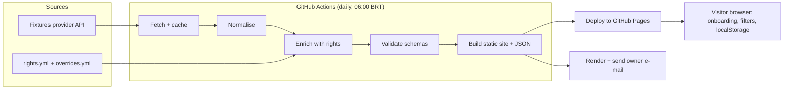

# Product Requirements Document: Ubi Ludus (Phase 1)

| | |
|---|---|
| **Name** | Ubi Ludus (Latin: "where is the game?"). Repository: `raissonls/ubi-ludus` |
| **Document status** | Draft v0.2 |
| **Owner** | Raisson Leal Silva (`@raissonls`) |
| **Date** | 2026-11-01 |
| **Phase** | 1 of N: "Personal MVP, public by design" |
| **Target launch** | 2026-12-20 (7 weeks, see [Timeline](#11-timeline-and-effort)) |
| **Documentation language** | English (all committed docs). Product UI language: Brazilian Portuguese (pt-BR) |

---

## 1. Summary

Every weekend the owner has the same problem: finding out *where a football match will be broadcast in Brazil*. The information is scattered across TV guides, club social media and broadcaster sites, and it changes without notice.

Phase 1 delivers a **free, automated, open-source tool** that:

1. Collects the match calendar for the competitions the owner follows.
2. Resolves, for every match, **which broadcasters and streaming services carry it in Brazil**, using a maintained rights table plus manual overrides.
3. Presents the result in an **engaging static website** (GitHub Pages) where each visitor chooses *their own teams and subscriptions*.
4. Sends the owner a **daily morning e-mail** with the day's matches and where to watch them.

The product starts as a personal tool, but the repository and the website are public from day one, so the design must be safe and understandable for strangers from the start.

## 2. Problem statement

| | |
|---|---|
| **Who** | Brazilian football fans, starting with the owner |
| **Pain** | Broadcast rights in Brazil are fragmented: free TV, pay TV, pay-per-view, several streaming services and YouTube channels. A single competition can span several of them, and individual matches get moved. Finding the answer means opening several sites and apps. |
| **Current workaround** | Manual search every weekend |
| **Cost of the problem** | Time, missed matches, uncertainty about which subscription is needed |

## 3. Goals and non-goals

### 3.1 Goals (Phase 1)

- **G1.** Answer "where can I watch my team's next matches?" in under 10 seconds from opening the site.
- **G2.** Deliver correct-enough broadcast information (target 85–90%) with minimal weekly manual effort.
- **G3.** Run entirely on free services (**R$ 0/month**).
- **G4.** Be genuinely enjoyable to use: a polished, fast, responsive and accessible interface.
- **G5.** Be safe to run in a public repository (no leaked secrets, no personal data collected).
- **G6.** Be built in the open with clear documentation, tests and CI, as a project the owner enjoys maintaining.

### 3.2 Non-goals (Phase 1)

- User accounts, passwords or any server-side user data.
- E-mail or push notifications for anyone other than the owner.
- Live scores, lineups, statistics, predictions or betting odds.
- Sports other than football (soccer).
- Native mobile apps.
- Scraping content behind paywalls or logins.
- Using club crests or other trademarked artwork (see [Risks](#12-risks-and-mitigations)).
- Monetisation.

## 4. Users and personas

| Persona | Description | Phase 1 support |
|---|---|---|
| **Owner (primary)** | Football enthusiast and data professional. Follows a handful of clubs plus the main competitions. Has several streaming subscriptions. Wants a daily morning briefing and a site to check on the go. | Full: site + daily e-mail |
| **Visitor (secondary)** | Any Brazilian fan who finds the public site. Picks their teams and subscriptions once and returns. | Site only; preferences stored in their own browser |

## 5. Scope

### 5.1 Competitions covered

| Group | Competitions |
|---|---|
| Brazil | Brasileirão Série A, Copa do Brasil, state championships |
| South America | Copa Libertadores, Copa Sul-Americana |
| Europe and national teams | Major European leagues and the Champions League, World Cup and qualifiers, other national-team matches |

> **Important:** free data providers rarely cover all of these. The exact list per provider is validated in the Milestone 0 spike (see [FR-01](#61-data-collection) and [Risk R1](#12-risks-and-mitigations)). Competitions without reliable free data are listed in the UI as "not covered yet" instead of silently missing.

### 5.2 Broadcasters modelled

Free-to-air TV, pay TV, pay-per-view, streaming services (including the ones the owner subscribes to) and YouTube channels. The initial catalogue is maintained in `data/rights/broadcasters.yml`.

## 6. Functional requirements

Priorities use MoSCoW: **M**ust, **S**hould, **C**ould. Every requirement has an acceptance criterion (AC) that can be tested.

### 6.1 Data collection

| ID | Pri | Requirement | Acceptance criteria |
|---|---|---|---|
| FR-01 | M | Fetch fixtures for the covered competitions from one or more free providers through a **provider adapter interface**. | Adding a provider requires only a new adapter module and a config entry. Unit tests run adapters against recorded fixtures (no live calls in CI). |
| FR-02 | M | Normalise provider data into the internal model ([section 8](#8-data-model)). | Output validates against the JSON Schema in `schemas/`. Invalid output fails the pipeline. |
| FR-03 | M | Respect provider rate limits and terms. Cache responses between runs. | Pipeline never exceeds the provider's documented rate limit. Total calls per run are logged. |
| FR-04 | M | Keep a rolling window of matches: yesterday through the next 14 days. Competitions whose only free provider limits the horizon (see [provider comparison](research/provider-comparison.md)) keep yesterday through tomorrow. | Each competition has a configured horizon (14 days or until tomorrow). `matches.json` contains only matches inside that competition's window. |
| FR-05 | S | Detect and report postponed, rescheduled or cancelled matches. | A match whose kickoff changes between runs is flagged `rescheduled` for 48 hours. |
| FR-06 | M | Convert all times to **America/Sao_Paulo** for display; store UTC. | Test cases around midnight show the correct local date. |

### 6.2 Broadcast resolution

| ID | Pri | Requirement | Acceptance criteria |
|---|---|---|---|
| FR-10 | M | Maintain a **rights table** (`data/rights/rights.yml`) mapping *competition + season (+ optional round or stage)* to one or more broadcasters. | Table is human-readable YAML, validated by schema in CI, with `valid_from` / `valid_to` per rule. |
| FR-11 | M | Support **match-level overrides** (`data/rights/overrides.yml`) that win over rules. Overrides can add, replace or remove broadcasters. | Override precedence is covered by unit tests. |
| FR-12 | M | Tag every broadcast with a **confidence level**: `confirmed` (override or provider data), `rule` (from the rights table) or `unknown`. | The UI shows a different visual state for each level. No match is shown with a broadcaster without a confidence tag. |
| FR-13 | M | When nothing is known, show "Broadcast not confirmed yet" instead of guessing. | Matches with `unknown` never display a broadcaster name. |
| FR-14 | S | Produce a weekly **review report** (GitHub issue or Markdown artifact) listing matches of followed teams that are `unknown`, plus rights rules expiring within 30 days. | Report generated automatically every Thursday. |
| FR-15 | C | Optional lookups from secondary sources to propose overrides (never auto-applied). | Proposals appear only in the review report. |

### 6.3 Website

| ID | Pri | Requirement | Acceptance criteria |
|---|---|---|---|
| FR-20 | M | **Onboarding: "Which teams do you follow?"** First-time visitors see a friendly picker with type-ahead search and multi-select. | A new visitor can select teams and see their matches in ≤ 3 interactions. Works with keyboard and screen reader. |
| FR-21 | M | **Onboarding: "Which services do you have?"** Visitors select their subscriptions (for example free TV only, pay TV, specific streaming services). | Matches show whether they are watchable with the visitor's services. |
| FR-22 | M | Preferences are stored **only in the visitor's browser** (`localStorage`). They can be edited or cleared at any time. | No network request carries preferences. A "Reset my data" control exists. |
| FR-23 | M | **Home view**: "Today", "This week" and "Next matches of my teams", with followed teams highlighted and other notable matches below. | Followed-team matches always appear before other matches. |
| FR-24 | M | Each match card shows: teams, competition, local kickoff time, broadcaster badges and confidence state. | Visual regression snapshots cover all states (confirmed, rule, unknown, live, finished). |
| FR-25 | M | Mark broadcasters the visitor **can access** with their services; highlight matches they cannot watch. | Filter "only what I can watch" works and persists. |
| FR-26 | S | **Live-now** indicator and kickoff countdown. | Updates without page reload; correct around kickoff. |
| FR-27 | S | Filters by competition and broadcaster; free-text team search. | Filters combine (AND) and are reflected in the URL. |
| FR-28 | S | **Add to calendar** (`.ics`) per match and for all followed teams. | Generated file imports into Google Calendar and Apple Calendar. |
| FR-29 | S | Shareable view via URL parameters (teams and services), without personal data. | Opening the link reproduces the same view on another device. |
| FR-30 | M | Visible **data freshness** indicator ("Updated today at 06:12") and a link to report a wrong broadcast (pre-filled GitHub issue). | Indicator turns to a warning state if data is older than 36 hours. |
| FR-31 | M | Light and dark themes; respect `prefers-color-scheme` and `prefers-reduced-motion`. | Manual verification plus automated accessibility checks. |
| FR-32 | M | Clear, graceful states for loading, offline, empty data and errors. | Each state has a designed screen and a test. |
| FR-33 | C | Installable PWA with offline cache of the last data. | Passes PWA installability checks. |
| FR-34 | M | Competitions with a short data horizon are labeled so the visitor knows data is only available until tomorrow, and never looks like "no matches". | Matches and views of those competitions show the notice (for example "Data for this competition is available only until tomorrow"). The label is driven by the competition's configured horizon. Covered by a test. |

#### Experience principles (what "really nice to use" means)

- **Instant answer first.** The most relevant match of the visitor's teams is visible without scrolling or clicking.
- **Personal by default.** After onboarding, the site feels made for the visitor: their teams' colours accent the interface (colours only, no crests).
- **Calm motion.** Purposeful transitions (card entrance, onboarding steps, live pulse). All motion is disabled under reduced-motion.
- **Mobile first.** Designed for a phone in one hand on a Saturday; scales up to desktop.
- **Honest data.** Uncertainty is shown, never hidden.
- **Fast.** No framework required; small, dependency-light bundle.

### 6.4 Daily e-mail (owner only)

| ID | Pri | Requirement | Acceptance criteria |
|---|---|---|---|
| FR-40 | M | Send one e-mail per day, in the morning, listing today's matches of the owner's teams first and notable matches after, with broadcasters, kickoff times (BRT) and a "watchable with my services" marker. | E-mail is sent by 08:00 BRT on at least 95% of days over a rolling 30-day window. |
| FR-41 | M | Owner preferences (teams, services, e-mail template options) live in `config/owner.yml`. The **e-mail address and credentials are GitHub Secrets**, never in the repo. | Secret scanning finds nothing; a missing secret fails the job with a clear message. |
| FR-42 | S | Skip the e-mail on days with no relevant matches, or send a short "no matches today" note (configurable). | Configurable flag with tests for both behaviours. |
| FR-43 | S | Plain-text alternative and an HTML layout that renders correctly in Gmail (web and mobile) and Apple Mail. | Checked manually with two clients before launch. |
| FR-44 | C | Alert when a match already included in a sent e-mail changes time or broadcaster. | Alert sent at most once per change. |

### 6.5 Operations and quality

| ID | Pri | Requirement | Acceptance criteria |
|---|---|---|---|
| FR-50 | M | A scheduled GitHub Actions workflow runs the full pipeline daily (fetch → normalise → enrich → validate → build → deploy → e-mail). | Scheduled run at 09:00 UTC (06:00 BRT); manual trigger available (`workflow_dispatch`). |
| FR-51 | M | Failure notification to the owner (GitHub notification and/or e-mail). | A forced failure produces a notification within 15 minutes. |
| FR-52 | M | **Keep-alive** so GitHub does not disable the scheduled workflow after 60 days without repository activity. | Documented mechanism, verified by a dry-run. |
| FR-53 | M | CI on every pull request: lint, type-check, unit tests, schema validation, secret scan, front-end accessibility and Lighthouse checks. | Required status checks block merging. |
| FR-54 | S | Structured logs and a small `status.json` (last success, record counts, unknown ratio) published with the site. | Used by FR-30 and by the success metrics. |

## 7. Non-functional requirements

| Area | Requirement |
|---|---|
| **Cost** | R$ 0/month. Only free tiers (GitHub Free, free provider plans, free e-mail sending). |
| **Performance** | Lighthouse (mobile) ≥ 90 for Performance, Accessibility, Best Practices and SEO. Largest Contentful Paint ≤ 2.5 s on simulated 4G. Total JS ≤ 100 KB gzipped. |
| **Accessibility** | WCAG 2.2 AA. Full keyboard navigation, visible focus, sufficient contrast, labelled controls. |
| **Reliability** | Pipeline success ≥ 95% over 30 days. If providers fail, the previous good dataset stays published and the freshness indicator warns the visitor. |
| **Privacy** | No accounts, no cookies, no third-party trackers, no analytics that identify people. Preferences stay in the browser. Privacy notice in the footer. Compatible with Brazil's LGPD for this scope. |
| **Browser support** | Last 2 versions of Chrome, Safari, Firefox and Edge, on mobile and desktop. |
| **Localisation** | pt-BR UI. Strings isolated in one file to allow future locales. Dates, times and plurals formatted with `Intl`. |
| **Maintainability** | Type hints, linting and formatting enforced; ≥ 80% line coverage on pipeline code; architecture decisions recorded in `docs/adr/`. |
| **Documentation** | All repository documentation in English: README, PRD, architecture, contributing guide, runbook, ADRs. |

## 8. Data model

```text
Team          id, name, short_name, aliases[], country, colors{primary, secondary}
Competition   id, name, country_or_region, type, provider_ids{}
Match         id, competition_id, season, round, kickoff_utc, home_team_id,
              away_team_id, status (scheduled|live|finished|postponed|cancelled|rescheduled)
Broadcaster   id, name, kind (free_tv|pay_tv|ppv|streaming|youtube), service_id|null, url
Service       id, name, includes_broadcasters[]
Broadcast     match_id, broadcaster_id, confidence (confirmed|rule|unknown), source, updated_at
RightsRule    competition_id, season, scope (all|round|stage|team), broadcasters[], valid_from, valid_to, notes
Override      match_id, action (add|replace|remove), broadcasters[], reason, added_at
```

Published artefacts (static JSON, versioned schema): `matches.json`, `teams.json`, `competitions.json`, `broadcasters.json`, `status.json`.

## 9. Solution overview



Key decisions:

- **No runtime backend.** The pipeline generates static JSON once a day; the browser does all personalisation. This keeps cost at zero, removes most of the attack surface and scales to any number of visitors.
- **Python 3.12** for the pipeline and e-mail. **Vanilla HTML/CSS/JS** (ES modules) for the site; any build tooling stays minimal.
- **Deploy with the Pages artefact action** instead of committing generated data on every run, to keep the git history clean.
- **Provider adapters** isolate us from any single data source.

Proposed repository layout:

```text
.github/workflows/   pipeline.yml, ci.yml, review-report.yml
config/              owner.yml, competitions.yml
data/rights/         broadcasters.yml, services.yml, rights.yml, overrides.yml
schemas/             *.schema.json
src/pipeline/        providers/, normalise.py, enrich.py, publish.py
src/email/           render.py, send.py, templates/
site/                index.html, assets/, js/, css/, i18n/pt-BR.json
tests/               unit/, fixtures/, e2e/
docs/                PRD.md, architecture.md, runbook.md, adr/
```

## 10. Success criteria

Phase 1 is **done** only when every "Must" criterion below is met for **14 consecutive days** after launch.

| # | Criterion | Target | How it is measured |
|---|---|---|---|
| S1 | Broadcast accuracy | ≥ 85% of audited matches correct (stretch 90%) | Each week the owner audits a sample of at least 10 matches of followed teams against the official source after the match; results logged in `docs/audits/`. |
| S2 | Coverage | ≥ 90% of followed-team matches have a non-`unknown` broadcast; ≥ 70% of all listed matches | Computed from `status.json` daily. |
| S3 | Freshness | Data published by 07:00 BRT on ≥ 95% of days | Timestamp in `status.json` plus workflow history. |
| S4 | E-mail reliability | Delivered by 08:00 BRT on ≥ 95% of days | Workflow logs and the owner's inbox. |
| S5 | Pipeline reliability | ≥ 95% successful scheduled runs | GitHub Actions history. |
| S6 | Time to answer | A first-time visitor finds their team's next match and where to watch it in ≤ 30 s; a returning visitor in ≤ 10 s | Moderated test with at least 5 people (family and friends), stopwatch-timed. |
| S7 | Usability | ≥ 4 of 5 test users complete onboarding unaided | Same test sessions. |
| S8 | Site quality | Lighthouse mobile ≥ 90 in all four categories; zero critical axe accessibility violations | CI report on `main`. |
| S9 | Cost | R$ 0 spent | Monthly check of all accounts. |
| S10 | Security hygiene | 0 secrets in git history; 0 high/critical Dependabot alerts open > 7 days; all workflow permissions least-privilege | Secret scan, Dependabot, manual workflow review. |
| S11 | Owner effort | ≤ 30 min of maintenance per week after launch | Owner's own log for the 14-day window. |
| S12 | Owner satisfaction | The owner uses the e-mail or site on ≥ 5 of 7 days in the final week and would not go back to manual searching | Owner's own judgement (explicit yes/no). |

### Definition of done for launch

- All "Must" requirements implemented and tested.
- CI green; documentation complete in English.
- Security checklist ([section 13](#13-security-and-privacy)) signed off.
- Runbook tested by simulating a provider outage.
- Public announcement is optional and does not block launch.

## 11. Timeline and effort

**Capacity assumption:** about 2 h on each weekday and 4 h on each weekend day, which is **18 h/week**. Estimated scope is about 105 h plus buffer, which makes **7 weeks**.

| Milestone | Weeks (2026) | Est. hours | Outcome |
|---|---|---|---|
| **M0 Discovery spike** | W1 (Nov 2–8) | 12 | Provider comparison with real calls: which competitions are covered, rate limits, terms of use on republishing data. Decision on provider(s). Repo scaffold, CI skeleton, ADR-001 (architecture). |
| **M1 Data pipeline** | W2 (Nov 9–15) | 18 | Fetch, normalise, validate, cache. Fixtures for the covered competitions in `matches.json`. |
| **M2 Rights engine** | W3 (Nov 16–22) | 16 | Rights table, overrides, confidence levels, review report. Initial rights data curated. |
| **M3 Website core** | W4–W5 (Nov 23–Dec 6) | 36 | Onboarding, home views, match cards, preferences, filters, freshness indicator, themes. |
| **M4 E-mail and operations** | W6 (Dec 7–13) | 14 | Daily e-mail, scheduled workflow, notifications, keep-alive, runbook. |
| **M5 Hardening and launch** | W7 (Dec 14–20) | 14 | Accessibility and performance tuning, usability sessions, security checklist, 14-day measurement window begins. |

Success measurement (14 days) runs Dec 21 – Jan 3; Phase 1 closure review is Jan 4, 2027.

## 12. Risks and mitigations

| ID | Risk | Likelihood | Impact | Mitigation |
|---|---|---|---|---|
| R1 | No free provider covers all competitions (especially state championships, Copa do Brasil, South American cups). | High | High | M0 spike decides coverage up front. Provider adapters allow combining sources. Uncovered competitions are shown as "not covered" rather than hidden. Option of curated calendars maintained as YAML. |
| R2 | Provider terms may forbid republishing raw data on a public site. | Medium | High | Read terms in M0. Publish only the minimum derived fields, attribute the source, and prefer providers that allow it. Fall back to curated data where not allowed. |
| R3 | Broadcast rights change mid-season and individual matches move. | High | Medium | Confidence levels, overrides, weekly review report, visible "report an error" link. Expectation set in the UI and README. |
| R4 | Scraping guide sites could breach their terms or break without notice. | Medium | Medium | Phase 1 does **not** scrape. Secondary sources only feed human-reviewed proposals (FR-15). |
| R5 | Club names, crests and competition logos are trademarked. | Medium | Medium | Text and colours only in Phase 1. Revisit with legal advice in Phase 2. |
| R6 | Scheduled workflows are delayed or disabled by GitHub (up to a delay at peak times; disabled after 60 days of repo inactivity). | Medium | Medium | 30-minute tolerance in targets, keep-alive job (FR-52), failure alerts (FR-51). |
| R7 | Leaking secrets in a public repository. | Low | High | Secrets only in GitHub Secrets, pre-commit and CI secret scanning, no secrets in logs, least-privilege tokens. |
| R8 | Free e-mail sending limits or deliverability problems (spam folder). | Medium | Low | Send to a single known recipient, mark sender as safe, keep volume at 1/day; fall back to an alternative free SMTP/API provider. |
| R9 | Owner time shortfall. | Medium | Medium | Strict MoSCoW; "Could" items are cut first; buffer built into the 7 weeks. |
| R10 | Scope creep toward Phase 2 (accounts, notifications). | Medium | Medium | Non-goals are explicit; ideas go to GitHub issues labeled `backlog`. |

## 13. Security and privacy

Because the repository and site are public from day one, the following are **requirements**, not nice-to-haves.

**Secrets and access**
- E-mail credentials and any API keys live only in GitHub Secrets. The owner's e-mail address is never committed.
- Workflow `permissions:` set explicitly to the minimum per job. Third-party actions pinned to commit SHAs. Dependabot enabled for Actions, Python and npm.
- Branch protection on `main`; required status checks; no force pushes. Two-factor authentication on the owner's GitHub account.
- Secret scanning and push protection enabled; a secret-scan step in CI.

**Application security**
- The site renders data with safe DOM APIs (`textContent`), never raw `innerHTML` with data.
- Content Security Policy via `<meta http-equiv>` (GitHub Pages cannot set headers): no inline scripts, same-origin scripts and styles, no third-party hosts.
- No third-party scripts or fonts loaded from CDNs (self-host to avoid supply-chain risk and tracking). If any external asset is unavoidable, use Subresource Integrity.
- Inputs from URL parameters are validated against an allow-list of team and service IDs.
- Generated `.ics` and e-mail content are escaped.

**Privacy**
- No cookies, no analytics that identify visitors. If aggregate analytics are ever added, they must be cookieless and documented.
- Team and service choices never leave the browser.
- A short privacy notice in the site footer and a `PRIVACY.md` in the repo.

**Operational**
- Provider API usage respects rate limits and terms; user-agent identifies the project.
- Runbook covers: rotating a leaked secret, switching provider, disabling the e-mail, rolling back the site.

## 14. Roles and expertise needed

Phase 1 is delivered by the **owner with Claude as pair-programming and review partner**. The table lists every function the solution needs, who covers it now, and when real specialists would become necessary.

| Role | Responsibilities in this project | Phase 1 owner | When an external specialist is needed |
|---|---|---|---|
| **Product owner** | Priorities, scope, acceptance, success metrics, rights-table curation | Owner | Phase 2 if the audience grows and needs research |
| **Backend / data engineer (Python)** | Provider adapters, normalisation, rights engine, schemas, caching, tests | Owner + Claude | If more providers or heavy data volume appear |
| **Front-end developer** | Onboarding, views, filters, state, performance | Owner + Claude | If the app grows beyond static pages (PWA, rich animation) |
| **UX / visual designer** | Interaction flow, visual identity, motion, accessibility patterns | Owner + Claude (design tokens and component sketches) | Strongly recommended before a public marketing push; a short design review is the most valuable outside input |
| **Security / information-security engineer** | Threat model, secrets handling, CSP, dependency and supply-chain hygiene, review of this PRD's section 13 | Owner + Claude using the checklist | A one-off external review before opening to a wide audience or adding any user data |
| **DevOps / release engineer** | GitHub Actions, Pages deployment, scheduling, alerts, keep-alive | Owner + Claude | Not needed in Phase 1 |
| **QA / accessibility tester** | Test plan, usability sessions, screen-reader and keyboard checks | Owner + 5 volunteers (family and friends) | Accessibility audit if public usage grows |
| **Content / rights curator** | Keeps rights and overrides correct, weekly audit | Owner (≈ 30 min/week) | Community maintainers via pull requests in Phase 2 |
| **Legal / compliance advisor** | Provider terms, trademark use, LGPD | Owner (reads the terms) | Before using crests/logos, adding accounts or any monetisation |

## 15. Dependencies and assumptions

- GitHub Free plan: Actions, Pages and Secrets available for a public repository.
- At least one free data provider offers acceptable coverage and terms (validated in M0).
- A free way to send e-mail from a scheduled job (for example SMTP with an app password, or a free-tier transactional e-mail API).
- The owner can dedicate about 18 h/week.
- Brazil does not currently observe daylight saving time, but time handling must use the IANA zone `America/Sao_Paulo` rather than a fixed offset.

## 16. Open questions

| # | Question | Owner | Needed by |
|---|---|---|---|
| Q1 | Which exact teams does the owner follow? (stored in `config/owner.yml`) | Owner | M2 |
| Q2 | ~~Which provider(s) cover each competition, and what do their terms say about republishing?~~ **Resolved 2026-11-01:** football-data.org (14 days) plus API-Football (until tomorrow only). Details and terms in [docs/research/provider-comparison.md](research/provider-comparison.md). | Owner + Claude | End of M0 |
| Q3 | Which e-mail sending method will be used? | Owner | M4 |
| Q4 | ~~Final project name and repository name~~ **Resolved 2026-11-01: Ubi Ludus (`ubi-ludus`).** Still to check before going public: domain, social handles and similarly named apps. | Owner | M0 |
| Q5 | Which streaming services does the owner currently subscribe to, so the service catalogue and defaults are correct? | Owner | M3 |
| Q6 | Should Phase 2 allow visitors to receive their own e-mails? If yes, it brings accounts, consent and LGPD obligations | Owner | Phase 2 planning |

## 17. Phase 2 preview (not committed)

Possible next steps once Phase 1 succeeds: visitor-chosen notifications (web push or opt-in e-mail), community contributions to rights data, crest licensing, more sports, a calendar subscription feed (`webcal`), and optional paid data sources if usage justifies the cost.

## 18. Glossary

- **BRT:** Brasília Time (UTC−3).
- **Rights table:** the maintained mapping of competition and season to broadcasters.
- **Override:** a match-level correction that takes precedence over the rights table.
- **Confidence:** how sure we are about a broadcast: `confirmed`, `rule` or `unknown`.
- **PPV:** pay-per-view.
- **MoSCoW:** Must / Should / Could prioritisation.
