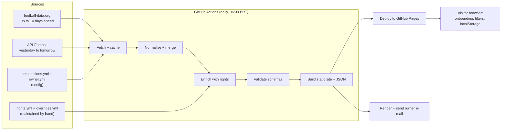

# Architecture

How Ubi Ludus fits together. This is a living overview: it starts as a skeleton in M0 and gets filled in as each milestone lands. The reasons behind the big choices are in [ADR-001](adr/ADR-001-architecture.md), and the product behaviour is in the [PRD](PRD.md).

## In one paragraph

A scheduled GitHub Actions job runs once a day. It fetches fixtures from two free data providers, cleans and merges them, adds broadcast information from our own rights table, validates the result, and publishes static JSON files plus a static website to GitHub Pages. It also sends the owner a morning e-mail. Visitors' browsers download the JSON and do all the personalisation locally, so there is no server and nothing personal is stored anywhere but the visitor's own browser.

## Data flow

If a step fails, the previous good data stays published and the site's freshness indicator warns the visitor.

## Components

| Part | Where | What it does | Built in |
|---|---|---|---|
| Provider adapters | `src/ubi_ludus/pipeline/providers/` | One module per data source behind a common interface | M1 ([#8](../../../issues/8), [#9](../../../issues/9), [#53](../../../issues/53)) |
| Normalise and merge | `src/ubi_ludus/pipeline/` | Turns provider data into our model, matches team names, removes duplicates, converts times | M1 ([#10](../../../issues/10)) |
| Cache and rate limiting | `src/ubi_ludus/pipeline/` | Avoids repeat calls, stays under each provider's limit | M1 ([#11](../../../issues/11)) |
| Rolling window | `src/ubi_ludus/pipeline/` | Keeps only each competition's allowed window; flags rescheduled matches | M1 ([#12](../../../issues/12)) |
| Rights engine | `src/ubi_ludus/pipeline/` | Resolves broadcasters per match with a confidence level; applies overrides | M2 ([#14](../../../issues/14), [#15](../../../issues/15)) |
| Rights data | `data/rights/` | Broadcasters, services, rules and overrides, edited by hand | M2 ([#13](../../../issues/13), [#16](../../../issues/16)) |
| Schemas | `schemas/` | JSON Schemas that validate every published file | M1 ([#7](../../../issues/7)) |
| Website | `site/` | Static pages, onboarding, filters, match cards, calendar export | M3 ([#18](../../../issues/18) onwards) |
| Daily e-mail | `src/ubi_ludus/email/` | Renders and sends the morning briefing to the owner | M4 ([#30](../../../issues/30), [#31](../../../issues/31)) |
| Workflows | `.github/workflows/` | CI on pull requests now; the daily pipeline and review report later | M0 ([#4](../../../issues/4)), M4 ([#32](../../../issues/32)) |
| Config | `config/` | Which provider serves each competition and its horizon; the owner's teams and services | M1, M2 |

## Published files

Static JSON with a schema version, served next to the site: `matches.json`, `teams.json`, `competitions.json`, `broadcasters.json` and `status.json` (last success, record counts, unknown ratio). Only the fields the site needs are published: no raw provider payloads, no crests or logos. The data model is in [PRD section 8](PRD.md#8-data-model).

## Schedule and environments

- **CI** runs on every pull request and on `main` ([ci.yml](../.github/workflows/ci.yml)): lint, format, type-check, tests and a secret scan.
- **Daily pipeline** (from M4): 09:00 UTC (06:00 BRT) with a manual trigger, plus a keep-alive so GitHub does not disable the schedule after 60 days of inactivity.
- **Secrets** (provider keys, e-mail credentials) live only in GitHub Secrets and in a local `.env` that git ignores.
- **Local development:** see the README. Provider keys are optional for most work because tests use recorded fixtures, not live calls.

## Where the rest is documented

| Topic | Document |
|---|---|
| Why we chose this architecture | [ADR-001](adr/ADR-001-architecture.md) |
| Providers: coverage, limits, terms | [provider comparison](research/provider-comparison.md) |
| Security and the go-public plan | [security checklist](security-checklist.md) |
| How we plan and track work | [README](../README.md#how-we-plan-work) |

## To be written as the project grows

- Sequence of one daily run, with timings, once M4 exists.
- Rights resolution rules and override precedence (M2).
- Front-end structure, state handling and the pt-BR string file (M3).
- Runbook: rotate a leaked secret, switch provider, disable the e-mail, roll back the site ([#35](../../../issues/35)).
